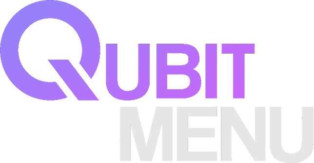

    
  
   Seralyth、ii's Stupid Menu からのフォーク 

---

	
	
	
	

---

**Qubit** は、コミュニティによって、コミュニティのために作られた Gorilla Tag 用の **高機能モッドメニュー** です。モッドを使いたいだけの人から開発者まで、あらゆるニーズに対応します。**できる限り便利に** 設計されており、様々な機能とオプションで自分好みのモッド体験をカスタマイズできます。

  
<b>🌍 なぜオープンソース？</b>

いい質問です。モッドコミュニティはかつて **共有・学習・改善** を共に行う場所でした。しかし今では、すべてが **ペイウォールと難読化** の奥に閉じ込められています。それは本来のあるべき姿ではありません。

このメニューをオープンソースにすることで、**すべての人** に以下の機会を提供します：
- モッドメニューの仕組みを学ぶ
- 新しいアイデアを試す
- Gorilla Tag モッドシーンに貢献する
- 🔓 **モッドを無料で開かれたものに保つ**

モッドの協力文化を取り戻しましょう。ペイウォールなし、秘密なし、マルウェアなし、ただ良いモッドだけを。

  
<b>📦 コードを使ってもいい？</b>

**もちろん！** ただし条件があります：公平にプレイすること。**[GPL-3.0 ライセンス](https://www.gnu.org/licenses/gpl-3.0.html)** が適用されます。つまり：
- あなたのプロジェクトも **必ず** オープンソースにする
- クレジットをきちんと表記する
- 怪しいことをしない
- **[ライセンスに従う](https://www.gnu.org/licenses/gpl-3.0.html)**

  
<b>⬇️ ダウンロード</b>

### 最新リリース
最新ビルムは **[リリースページ](https://github.com/QubitGT/Qubit/releases/latest)** から — 常に無料、常にオープン。

### Discord
助けが必要、モッドの提案、または雑談？ 
**[discord.gg/qubit](https://discord.gg/qubit)** のコミュニティに参加 💬

### English README
The English version of this README is available **[here](README.md)**.

  
<b>🛠️ インストール</b>

1. 最新リリースを **[ここ](https://github.com/QubitGT/Qubit/releases/latest)** から **ダウンロード**
2. `Qubit.dll` を plugins フォルダに **ドラッグ＆ドロップ**
3. Gorilla Tag を **起動** して楽しもう！

**🔧 ソースからビルド（開発者向け）**

1. ソースコードを **[ここ](https://github.com/QubitGT/Qubit/releases/latest)** からダウンロード
2. Gorilla Tag がカスタム場所にある場合、`Directory.Build.props` の `<GamePath>` を編集
3. `Ctrl + Shift + B` でプロジェクトをビルド 
🔧 DLL は自動的に Gorilla Tag の plugins フォルダに入ります

---

  
<b>💻 システム互換性</b>

| OS | メニュー | フォント | 画像 | 音声 | 動画 |
|----|:----:|:-----:|:------:|:------:|:------:|
| Windows 10|✅|✅|✅|✅|✅|
| Windows 11|✅|✅|✅|✅|✅|
| Mac OS|✅|✅|✅|✅|✅|
| Linux|✅|✅|✅|✅|✅|

> ✅ 正常動作 ; 🟡 一部機能 ; ❌ 動作しない ; ❔ 未検証

  
<b>🥽 ヘッドセット互換性</b>

| ヘッドセット | メニュー | モッド |
|---------|:----:|:----:|
|Rift|✅|✅|
|Rift S|✅|✅|
|Oculus Go|🟡|✅|
|Quest 1|✅|✅|
|Quest 2|✅|✅|
|Quest Pro|✅|✅|
|Quest 3/3s|✅|✅|
|Pico 4/Pro|✅|✅|
|Pico 4 Ultra Pro|✅|🟡|
|Valve Index|✅|✅|
|HTC VIVE/Pro|✅|🟡|
|HP Reverb G1/G2|✅|🟡|

> ✅ 完全動作 ; 🟡 限定的な動作 ; ❌ 機能しない ; ❔ 未検証

  
<b>📬 連絡先</b>

[Discord](https://discord.gg/qubit) に参加しよう！

  
<b>💛 サポート</b>

支援したい方は、以下の方法があります！

| プラットフォーム | リンク | アドレス |
|------------|------|---------|
| Ethereum   |  | [0xc14846DF02f45D02a3A5750B21e6e1533ab129Dd](ethereum:0xc14846DF02f45D02a3A5750B21e6e1533ab129Dd) |
| Litecoin   |  | [Ld5c7DVKgq7EnCLJs6DhwHi8eLhPYGQtC9](litecoin:Ld5c7DVKgq7EnCLJs6DhwHi8eLhPYGQtC9) |
| Patreon    |  | [Qubit](https://www.patreon.com/Qubit) |

> [!NOTE]
> メニューはテレメトリ、管理、TTS（音声合成）目的で https://api.qubit.mom にリクエストを送信します。 
> メニューは **AI アシスタント** モッドのため、https://oai.endpoints.kepler.ai.cloud.ovh.net にリクエストを送信します。（有効時） 
> メニューは多数の TTS ボイスのため、https://lazypy.ro にリクエストを送信します。 
> メニューはフレンドシステムと管理目的で wss://api.qubit.mom に接続します。 
> **このデータの収集と使用方法の詳細は [プライバシーポリシー](https://qubit.mom/policy) をお読みください。** 
> 寄付・検索・スター・スピークのシンボルは [Icons8](https://icons8.com) 提供です。

> Qubit Menu  README_JP.md 
> A community driven mod menu for Gorilla Tag with over 1000+ mods
>
> Copyright (C) 2026  Qubit Software  /Derivative work of Seralyth Software, Goldentrophy Software
> https://github.com/QubitGT/Qubit
>
> This program is free software: you can redistribute it and/or modify
> it under the terms of the GNU General Public License as published by
> the Free Software Foundation, either version 3 of the License, or
> (at your option) any later version.
>
> This program is distributed in the hope that it will be useful,
> but WITHOUT ANY WARRANTY; without even the implied warranty of
> MERCHANTABILITY or FITNESS FOR A PARTICULAR PURPOSE.  See the
> GNU General Public License for more details.
>
> You should have received a copy of the GNU General Public License
> along with this program.  If not, see <https://www.gnu.org/licenses/>.

> This product is not affiliated with Another Axiom Inc. or its videogames Gorilla Tag and Orion Drift and is not endorsed or otherwise sponsored by Another Axiom. Portions of the materials contained herein are property of Another Axiom. c2026 Another Axiom Inc.

  <b>QUBIT</b> 
  Built by the community. Powered by imagination.

